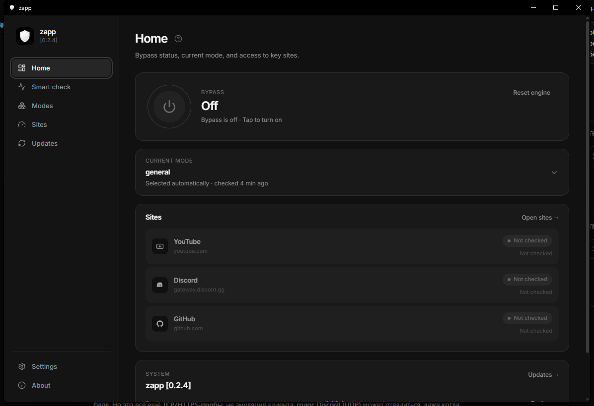

<div align="center">


# zapp

**Quiet Windows bypass for YouTube and Discord.**  
A soft-minimal client for zapret and the Flowseal strategy pack. One Smart check finds a working mode, then zapp stays out of the way in the tray.

[](https://github.com/krwg/zapp/releases/latest)
[](https://github.com/krwg/zapp/releases)
[](LICENSE)


[English](README.md) · [Русский](README.ru.md) · [Site](https://krwg.github.io/zapp/) · [Releases](https://github.com/krwg/zapp/releases)



</div>

I made zapp because I was tired of launching BAT files with a console window you shouldn’t close, guessing which Flowseal strategy fits your ISP, and babysitting `winws` by hand.

zapp wraps zapret and the [Flowseal strategy pack](https://github.com/Flowseal/zapret-discord-youtube) in a small Tauri app. Press Start on the Bypass card, approve UAC once, and `winws` runs hidden in the background.

- **Smart check** tries modes against YouTube and Discord and picks one that passes both. **Fast** (default) stops early when a mode scores strongly; **Thorough** tests every mode and ranks them.
- **Home** reports YouTube, Discord web and Discord voice separately, because one can work while another doesn’t.
- Modes that worked before are kept, so you can re-apply one in a click.
- While bypass is on, a **watchdog** (on by default, every few minutes; can be turned off in Settings) rechecks quietly and can re-run Smart check if you enable auto re-check.
- Before Start, zapp names competing tools such as GoodbyeDPI or other zapret GUIs.
- The app, the engine and the strategies update separately. The interface is in English and Russian, with light and dark themes and a tray icon.

zapp is not a VPN. Your IP stays visible and nothing is encrypted; the only thing that changes is how your packets look to DPI. Check that this is legal where you live.

## Install

1. Download `zapp_*_x64-setup.exe` from [Releases](https://github.com/krwg/zapp/releases/latest) and install it.
2. Open zapp (the first run shows a short wizard), press **Start**, approve the UAC prompt.
3. Wait while the engine pack downloads, then run **Smart check**.

Windows 10/11 x64. Admin rights are needed once, to start the helper.

I recommend the NSIS `setup.exe`: on a reinstall it can wipe the old app data. The `.msi` works too but has no cleanup page. SHA256 sums are in each release.

The installers are not Authenticode-signed yet ([why](docs/CODE_SIGNING_POLICY.md)), so SmartScreen may warn. Verify the hash or build from source. In-app updates are checked with minisign.

## What it does on your machine

`winws` uses [WinDivert](https://reqrypt.org/windivert.html), which loads a kernel driver, so it needs admin rights. zapp asks for UAC once and starts one elevated helper, `zapp-helper.exe`. The UI talks to it over a local named pipe (`\\.\pipe\zapp-helper`) with a token on every request. There is no network port. The pipe is open to your normal, unelevated user so the UI can connect. The token lives in `%LOCALAPPDATA%\zapp\helper.token` and is readable by your Windows user — any process under that account could talk to the helper; it never leaves the machine.

The engine pack is downloaded from GitHub on first run and when Engine or Strategies update. New installs (and elevated Engine installs) keep it in `%ProgramData%\zapp\engine\`, writable only by admins. Older packs and fallbacks use `%APPDATA%\app.zapp.desktop\engine\`. After an upgrade from 0.2.6, your existing pack keeps working; the next Engine install prefers ProgramData.

There is no telemetry. Apart from GitHub release checks, traffic goes to YouTube, Discord and hosts you add — when you run Smart check, when Home opens with bypass on (silent site probes), and while the watchdog is active. Settings and logs live in `%APPDATA%\app.zapp.desktop\`, helper state in `%LOCALAPPDATA%\zapp\`.

Antivirus and SmartScreen sometimes flag WinDivert-based tools, because a packet-filter driver looks suspicious by nature. The source is open, so you can check the installer's SHA256 or build it yourself.

## Known rough edges

- Smart check and the path verdicts use TCP/HTTPS plus a light UDP check, not a real Discord or YouTube client. Voice can still fail while the web looks fine; Home shows that gap on purpose.
- The first launch needs GitHub to download the engine pack. Updates can import a zip, but there is no offline pack browser yet.
- Closing the window hides zapp in the tray and it keeps running. Quit from the tray before reinstalling (Quit also stops `winws` and the helper), or the setup can’t replace `zapp.exe`.
- Windows 10/11 x64 only. No macOS or Linux build.

## If something doesn't work

If SmartScreen blocks the installer, choose *More info → Run anyway*, or verify the SHA256 first. If no mode passes Smart check, close other zapret, VPN or DPI tools and run it again. If a Flowseal `.bat` left `winws.exe` running, stop it first; Smart check will tell you.

To remove zapp completely, uninstall it and accept the cleanup prompt. By hand, delete `%APPDATA%\app.zapp.desktop`, `%LOCALAPPDATA%\zapp` and, if present, `%ProgramData%\zapp`.

## Build from source

```bash
npm install
npm run tauri:dev     # desktop app
npm run tauri:build   # NSIS + MSI
```

You need the Rust toolchain and MSVC Build Tools. Architecture notes are in [docs/ARCHITECTURE.md](docs/ARCHITECTURE.md). Per-version changes are on the [Releases](https://github.com/krwg/zapp/releases) page.

## Credits

The engine isn't mine. zapp is the UI and the glue around it.

| Project | Author |
|---------|--------|
| [zapret](https://github.com/bol-van/zapret) | [bol-van](https://github.com/bol-van) |
| [zapret-discord-youtube](https://github.com/Flowseal/zapret-discord-youtube) | [Flowseal](https://github.com/Flowseal) |

zapp doesn't ship WinDivert or `winws`; their licenses stay with the upstream projects.

MIT · [krwg](https://github.com/krwg)
