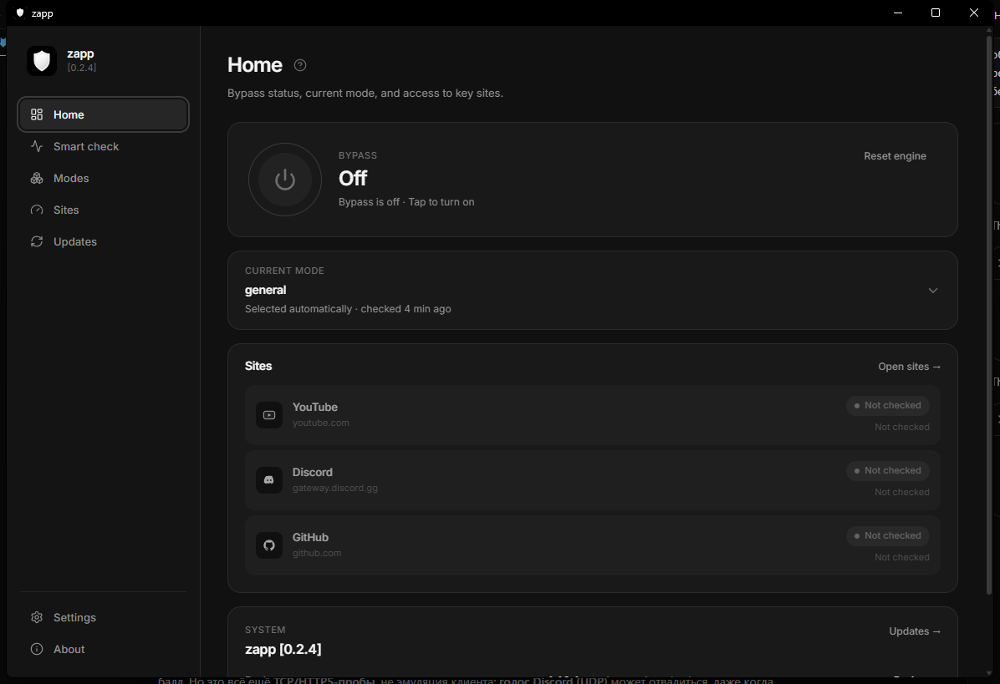

<div align="center">


# zapp

**Десктопный клиент для [zapret](https://github.com/bol-van/zapret) на Windows.**  
Запускает стратегию обхода DPI для YouTube и Discord без консольного окна.

[English](README.md) · [Русский](README.ru.md) · [Релизы](https://github.com/krwg/zapp/releases)



</div>

Я сделал zapp, потому что запускать BAT-файлы с консолью надоело: окно, которое нельзя закрыть, угадайка стратегии под провайдера и ручной присмотр за `winws`.

zapp оборачивает zapret и [пакет стратегий Flowseal](https://github.com/Flowseal/zapret-discord-youtube) в небольшое приложение на Tauri. На карточке **Обход** нажимаете Start, один раз подтверждаете UAC, и `winws` работает скрыто в фоне.

**Умная проверка** (по умолчанию Быстрый, есть Тщательный) прогоняет стратегии по YouTube и Discord на нескольких точках (сайт, gateway, медиа, CDN картинок, мягкий UDP) и включает режим, который проходит оба сервиса. С **0.2.4** цикл быстрее; **0.2.5** укрепляет lifecycle движка. **0.2.6** сохраняет его и добавляет усиление доверия (allowlist helper, Engine в ProgramData с ACL, SHA256 установщика), понятные ошибки с быстрым репортом, Markdown в заметках релизов и более умный рейтинг проверки. На Главной карточки сайтов серые, пока нет свежей пробы.

Приложение, движок и стратегии обновляются отдельно. Интерфейс на русском и английском, светлая и тёмная темы, можно свернуть в трей.

zapp не VPN. Ваш IP остаётся виден, ничего не шифруется, меняется только вид пакетов для DPI. Проверьте, что это законно там, где вы живёте.

## Установка

1. Скачайте `zapp_*_x64-setup.exe` со страницы [релизов](https://github.com/krwg/zapp/releases/latest) и установите.
2. Откройте zapp, нажмите **Start** на Обходе, подтвердите UAC.
3. Дождитесь загрузки пакета движка и запустите **Умную проверку**.

Windows 10/11 x64. Права администратора нужны один раз, чтобы запустить helper.

Советую NSIS `setup.exe`: при переустановке он умеет стирать старые данные приложения. `.msi` тоже работает, но без страницы очистки. SHA256 указаны в каждом релизе.

## Что происходит на вашей машине

`winws` использует [WinDivert](https://reqrypt.org/windivert.html), а он загружает драйвер ядра, поэтому нужны права администратора. zapp запускает один повышенный helper, `zapp-helper.exe`, и общается с ним через TCP-порт на `127.0.0.1` с токеном. Из сети он недоступен.

При первом запуске и при обновлении Engine или Strategies zapp скачивает пакет Flowseal с GitHub. Новые установки предпочитают `%ProgramData%\zapp\engine\` (elevated helper + ACL); запасной вариант — `%APPDATA%\app.zapp.desktop\engine\`. Обновления приложения идут из [krwg/zapp](https://github.com/krwg/zapp/releases). Кроме проверок релизов на GitHub и проб сайтов, которые вы запускаете сами, других запросов zapp не делает. Телеметрии нет. Настройки и логи — в `%APPDATA%\app.zapp.desktop\`, состояние helper — в `%LOCALAPPDATA%\zapp\`.

Антивирус и SmartScreen иногда ругаются на инструменты с WinDivert: драйвер-перехватчик пакетов по природе выглядит подозрительно. Исходники открыты, можно сверить SHA256 установщика или собрать самому.

## Известные шероховатости

Коротко перед установкой:

- Умная проверка в **0.2.6** по-прежнему требует и YouTube, и Discord и ранжирует режимы с учётом критичных и мягких баллов (CDN / STUN). Это **TCP/HTTPS плюс мягкий UDP**, не живой клиент: голос всё ещё может отвалиться при зелёных карточках.
- С **0.2.4+** проверка заметно быстрее и стабильнее; если после неё что-то всё ещё кривит — на странице «Режимы» можно включить стратегию вручную.
- Первый запуск тянет пакет движка с GitHub. Офлайн-выбора пакета в UI пока нет.
- Закрытие окна по умолчанию прячет в трей; процесс жив. Перед переустановкой **выйдите из трея** (с 0.2.5 Quit также останавливает `winws`/helper), иначе setup не заменит `zapp.exe`.
- Только Windows 10/11 x64. Сборок под macOS и Linux нет.

## Если что-то не работает

Если SmartScreen блокирует установщик, нажмите *Подробнее → Выполнить в любом случае* или сначала сверьте SHA256. Если ни одна стратегия не проходит проверку, закройте другие zapret, VPN и DPI-инструменты и запустите её снова. Если от Flowseal `.bat` остался живой `winws.exe` — остановите его: умная проверка об этом скажет.

Чтобы удалить zapp полностью, удалите его и согласитесь на очистку. Вручную: `%APPDATA%\app.zapp.desktop` и `%LOCALAPPDATA%\zapp`.

## Сборка из исходников

```bash
npm install
npm run tauri:dev     # десктопное приложение
npm run tauri:build   # NSIS + MSI
```

Нужны Rust и MSVC Build Tools. Архитектура описана в [docs/ARCHITECTURE.md](docs/ARCHITECTURE.md).

## Авторы движка

Движок не мой. zapp это интерфейс и обвязка вокруг него.

| Проект | Автор |
|--------|-------|
| [zapret](https://github.com/bol-van/zapret) | [bol-van](https://github.com/bol-van) |
| [zapret-discord-youtube](https://github.com/Flowseal/zapret-discord-youtube) | [Flowseal](https://github.com/Flowseal) |

zapp не содержит WinDivert и `winws`; их лицензии остаются за upstream-проектами.

MIT · [krwg](https://github.com/krwg)
